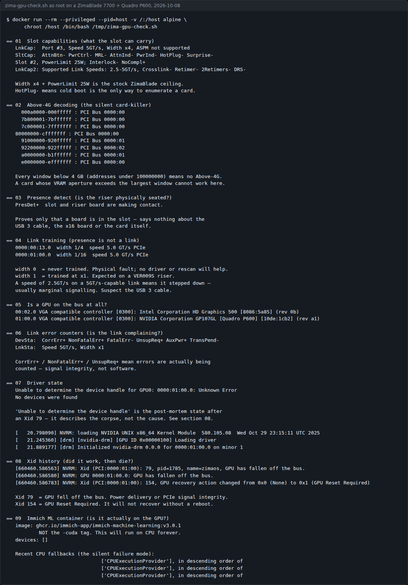
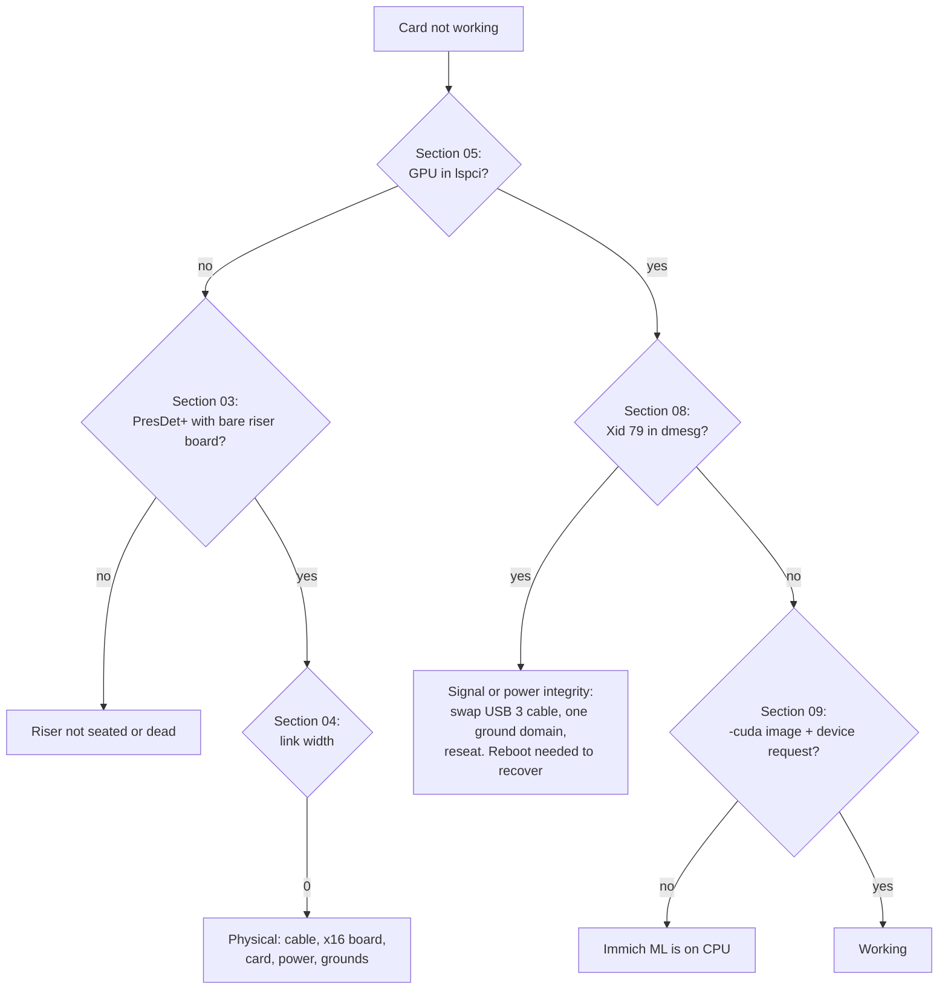

# Putting a GPU in a ZimaBlade

A field report and a read-only diagnostic script for anyone fitting a GPU to a ZimaBlade for Immich machine learning: the PCIe slot's real limits, the driver trap that breaks pre-Turing cards on ZimaOS, and how to read a card that works for hours and then falls off the bus.


[](LICENSE)


Every number here was read off a running machine, not a spec sheet, including the ones that stopped the build. The build is not finished: the card enumerates, the driver binds and Immich can use it, and then the GPU drops off the PCIe bus and stays gone until a reboot.

## Contents

- [What it does](#what-it-does)
- [Screenshots](#screenshots)
- [Quick start](#quick-start)
- [Usage](#usage)
- [Configuration](#configuration)
- [How it works: the field guide](#how-it-works-the-field-guide)
- [Status, limits and real results](#status-limits-and-real-results)
- [Licence and credits](#licence-and-credits)

## What it does

- **`diagnostics/zima-gpu-check.sh`** runs every check in the guide in one read-only pass: slot capabilities, Above-4G windows, presence detect, link training, whether a GPU is on the bus, link error counters, driver state, Xid history, and whether the Immich ML container is really on the GPU.
- It detects when it is running without root and says which sections need it, instead of printing empty output that looks like a hardware fault.
- **`immich/docker-compose.gpu.yml`** is the GPU fragment of a working Immich stack: the `-cuda` image and a per-container device request.
- **The guide** (below) covers reading the slot before you buy a card, why you should not install the open NVIDIA kernel module on a pre-Turing card, power and grounding with a riser, isolating a dead slot with presence detect, Immich v3 dropping Pascal and Maxwell, and reading Xid 79.

## Screenshots



`zima-gpu-check.sh` on the author's ZimaBlade 7700 with a Quadro P600 on a VER009S riser, 2026-10-08, run as root through a privileged container so all nine sections report. Captured as text and rendered to PNG; nothing edited.

## Quick start

You need a ZimaBlade (or another Linux box with a GPU in a PCIe slot) and a shell on it.

```bash
git clone https://github.com/casareanderson/zimablade-gpu-immich
cd zimablade-gpu-immich
bash diagnostics/zima-gpu-check.sh
```

Success looks like the screenshot: nine numbered sections. As a normal user, sections 04, 05, 07, 08 and 09 are accurate and the rest say they were skipped. For all nine, run it as root. On ZimaOS, where the SSH user has no sudo password, copy the script to the host's `/tmp` and run it with the host's own tools through a privileged container (this is how the screenshot was taken):

```bash
cp diagnostics/zima-gpu-check.sh /tmp/
docker run --rm --privileged --pid=host -v /:/host alpine \
  chroot /host /bin/bash /tmp/zima-gpu-check.sh
```

That container is root on the machine. Read the script before you run it that way. (The hint the script prints when run unprivileged mounts the script at `/w` and then `chroot`s, which hides `/w`; use the command above instead.)

## Usage

**Diagnose a card that isn't showing, or that died:**

```bash
bash diagnostics/zima-gpu-check.sh
```

Read section 04 first. `width 0` means the link never trained: a physical fault that no driver or rescan can fix. `width 1` is expected on a VER009S riser. A speed of 2.5 GT/s on a 5 GT/s link means it stepped down, usually from marginal signalling. Section 08 tells you whether it worked and then died.

**Put Immich machine learning on the GPU:** merge [`immich/docker-compose.gpu.yml`](immich/docker-compose.gpu.yml) into your existing Immich compose file, then check it took:

```bash
docker inspect immich-machine-learning --format '{{.Config.Image}}'
#   must end in -cuda
docker inspect immich-machine-learning --format '{{.HostConfig.DeviceRequests}}'
#   [{nvidia 1 [] [[gpu]]}]
```

Then watch the container's logs during a smart-search or face-detection job for the CPU fallback line (see [section 05](#05--wiring-it-into-immich)).

## Configuration

| Name | Default | What it does |
|---|---|---|
| `ROOT_PORT` | `00:13.0` | PCIe root port serving the ZimaBlade's slot. Override if your board differs. |
| `image` in the compose fragment | `ghcr.io/immich-app/immich-machine-learning:v3.0.1-cuda` | Must be a `-cuda` tag. For Pascal or Maxwell cards, see section 05. |
| `DEVICE` | `cuda` | Tells Immich ML to use CUDA |
| `NVIDIA_VISIBLE_DEVICES` | `all` | Which GPUs the container sees |
| `NVIDIA_DRIVER_CAPABILITIES` | `compute,utility` | Driver features exposed to the container |
| `deploy.resources.reservations.devices` | `driver: nvidia, count: 1, capabilities: [gpu]` | The per-container device request. Docker's default runtime can stay `runc`. |

## How it works: the field guide

**Hardware:** ZimaBlade 7700 (board ZBB001-BK10032) · NVIDIA Quadro P600 2 GB (GP107GL, Pascal) · VER009S powered riser · ZimaOS with NVIDIA 580.105.08 · Immich machine-learning v3.0.1-cuda



```
zimablade-gpu-immich/
├── diagnostics/zima-gpu-check.sh   the nine read-only checks
├── immich/docker-compose.gpu.yml   the GPU fragment of an Immich stack
└── docs/gpu-check.png              the screenshot above
```

### 01 · Read the slot before you spend money

The ZimaBlade has a PCIe slot, which is most of why people buy it. What the marketing doesn't tell you is what that slot can carry. Four values decide whether your card has any chance, and all four are readable from a running board in about ten seconds.

```console
$ lspci -vvv -s 00:13.0 | grep -E "LnkCap|SltCap"
LnkCap: Port #3, Speed 5GT/s, Width x4, ASPM not supported
SltCap: AttnBtn- PwrCtrl- MRL- AttnInd- PwrInd- HotPlug- Surprise-
        Slot #2, PowerLimit 25W; Interlock- NoCompl+
```

| Reading | Means | Consequence |
|---|---|---|
| `Speed 5GT/s, Width x4` | PCIe 2.0, four lanes | About 2 GB/s ceiling. Fine for compute and transcode, poor for gaming. |
| `PowerLimit 25W` | Slot power budget | A 40 W card **cannot** run slot-powered. You need external 12 V. |
| `HotPlug-` | No hot-plug | Enumeration happens at cold boot only. `/sys/bus/pci/rescan` will not save you. |
| All windows < 4 GB | No Above-4G decoding | The real blocker for big-VRAM cards. See below. |

**The Above-4G problem.** This is the one that quietly rules out the card you probably wanted. A GPU asks the host for a memory aperture roughly the size of its VRAM. Without Above-4G decoding, every PCI window has to live below the 4 GB line, and on this board the largest is about 1.25 GB:

```console
$ grep "PCI Bus" /proc/iomem
80000000-cfffffff : PCI Bus 0000:00     # about 1.25 GB, the largest window
  91000000-920fffff : PCI Bus 0000:01
```

A 2 GB Quadro P600 needs only a ~256 MB aperture and fits. A modern 12 GB or 16 GB card typically wants an aperture to match, and there is nowhere to put it. **Check your card's BAR sizes before buying, not after.**

### 02 · The driver trap

ZimaOS is an immutable, appliance-style OS, so the reasonable assumption is that you'll have to fight it to get NVIDIA drivers on. That assumption is wrong, and acting on it is how people break working setups.

**ZimaOS already ships the proprietary driver.** The full proprietary kernel module, plus the container toolkit for Docker GPU passthrough, baked into the base image rather than delivered as a system extension:

```console
$ which nvidia-smi nvidia-ctk nvidia-container-runtime
/usr/bin/nvidia-smi
/usr/bin/nvidia-ctk
/usr/bin/nvidia-container-runtime

$ dmesg | grep NVRM
NVRM: loading NVIDIA UNIX x86_64 Kernel Module  580.105.08

$ ls /var/lib/extensions/        # nvidia is NOT here; it's in the base image
icewhale_files.raw  icewhale_peerdrop.raw  manticore.raw  zimaos_zvm.raw
```

> **Do not install `nvidia-open-kernel` on an older card.**
>
> The widely shared ZimaOS tutorial for RTX 50-series cards tells you to drop `nvidia-open-kernel` into `/var/lib/extensions/` and run `install-nvidia-kernel-open`. That advice is correct **only for Blackwell**, where NVIDIA dropped proprietary support and open is the only option.
>
> The open module supports **Turing and newer only**. On anything older (Pascal, Maxwell, Volta) it will not bind to your card, and you will have replaced a working driver with one that cannot see your hardware. A GTX 1660 owner on the ZimaSpace forum hit exactly this and had to run `uninstall-nvidia-kernel-open` to recover.
>
> If your card is pre-Turing, the shipped proprietary driver is strictly better. Leave it alone.

Driver branch **580 is the last one to support Maxwell, Pascal and Volta**. A future ZimaOS bump to 590+ would drop those cards, and there is no kernel build tree on the box, so you cannot compile your way out.

> **Driver is not detection.** `lspci` enumeration happens with no driver loaded at all; a driver only binds to a device that is already on the bus. If your card isn't in `lspci`, no driver install will make it appear. Don't chase driver fixes while the link width reads `0`; that's a physical fault.

### 03 · Power, and one genuine fire hazard

The ZimaBlade takes its power **over USB-C**, not a barrel jack. Zima's own spec sheet lists a 36 W USB Type-C power adapter (12 V at 3 A); kits shipped since late 2025 include a 12 V / 5 A 60 W adapter instead, so check which one you have. On the 36 W supply, the board, RAM and two SATA drives already draw roughly 25–30 W. It cannot also feed a 40 W graphics card. An external supply is mandatory.

Most people reach for a powered mining riser, which is the right instinct. Two warnings come with it:

- **A VER009S riser is electrically x1**, despite the full x16 connector on top. The USB 3 cable is only the physical medium; no USB protocol is involved. Your ceiling becomes PCIe 2.0 x1, about 500 MB/s. Tolerable for CUDA and transcoding, useless for gaming.
- **Throw away the bundled SATA-to-6-pin adapter.** A SATA power connector is rated for around 54 W; a 6-pin PCIe connector is rated for 75 W and cards will try to draw it. These adapters are a well-documented fire risk. Use a proper Molex or native PCIe lead from the PSU.

> **Two power supplies means two ground domains.**
>
> If the ZimaBlade runs from its own two-pin (unearthed, floating) brick while the GPU runs from an earthed ATX supply, the only thing bonding those grounds is the thin ground wires in a USB 3 cable. PCIe uses differential signalling with a narrow common-mode range, and a floating offset between the domains produces the signature you'd least expect: **power is fine, and the data link never works.**
>
> Get both ends onto one ground. The ZimaBlade's input is USB-C, so there is no barrel jack to pigtail:
>
> - **Bond the grounds.** Run a wire from the ATX supply's COM (any black lead) to the ZimaBlade's ground. Cheapest test, and it leaves both supplies in place.
> - **Feed the board from the same supply as the card**, through a 12 V-to-USB-C lead. Check with a meter that your unit accepts fixed 12 V on VBUS first: Zima's own adapter is a fixed-12 V USB-C brick rather than a standard PD source.

### 04 · Diagnosing a slot that shows nothing

If the card doesn't appear, you need to know whether the problem is at the slot, the riser, the cable or the card. There is a neat way to split that question in half.

**Presence detect isolates the slot end.** On every PCIe card, pins A1 (`PRSNT1#`) and B17 (`PRSNT2#`) are shorted together on the card's own PCB. The host grounds A1 and pulls B17 high; seating a card pulls B17 low, and the slot reports `PresDet+`. That short is on the riser board itself, so it asserts presence purely by being seated, with no cable, GPU or external PSU attached. Plug the bare x1 riser board into the slot with nothing else connected, cold boot, and read it (root needed):

```console
$ lspci -vvv -s 00:13.0 | grep SltSta
SltSta: ... PresDet+ ...    # slot and riser board are making contact.
                            # Fault is downstream: cable, x16 board, card, power.
SltSta: ... PresDet- ...    # the riser isn't seated or is dead.
                            # Nothing downstream can matter yet.
```

> `PresDet+` proves only that the small board is in the slot. The pins it shorts are two of the ZimaBlade's own, inside the ZimaBlade's own ground domain. It says nothing about the USB 3 cable, the x16 board or the GPU. Use it to rule the slot **out**, not the rest **in**.

**Then check whether the link trained.** Presence is not a link. These files are readable by any user:

```console
$ cat /sys/bus/pci/devices/0000:00:13.0/current_link_width
0    # link never trained. Physical fault. Not fixable in software:
     # a rescan cannot train a width-0 link, and no driver will help.
1    # trained at x1. Expected on a VER009S riser.
```

### 05 · Wiring it into Immich

Immich's machine-learning container (face recognition and smart search) is the reason most people do this. It needs two things: the CUDA image variant and a device request. This configuration was read back off a live container:

```console
$ docker inspect immich-machine-learning
Image           ghcr.io/immich-app/immich-machine-learning:v3.0.1-cuda
DeviceRequests  [{nvidia 1 [] [[gpu]]}]
DEVICE=cuda
NVIDIA_VISIBLE_DEVICES=all
NVIDIA_DRIVER_CAPABILITIES=compute,utility
```

The plain image tag silently runs on CPU forever; you need the `-cuda` variant. Docker's `default` runtime can stay `runc`, because the per-container device request is what matters.

> **It fails safe, which is why you might not notice.** If the GPU disappears, Immich does not break. ONNX Runtime logs the failure and carries on:
>
> ```
> CUDA failure 100: no CUDA-capable device is detected
> Falling back to ['CPUExecutionProvider'] and retrying.
> ```
>
> Face recognition and smart search keep working, slowly. Good design, but a dead GPU can go unnoticed for days. Mine did: six.

**Check that Immich still supports your card at all.** Immich v3 dropped Maxwell and Pascal machine learning: ONNX Runtime no longer ships kernels for compute capability 5.2 and 6.1 in a single image, so the `v3.x-cuda` ML container will not run on a GTX 9xx, GTX 10xx or Quadro P-series card. The reported symptom is an immediate crash, exit code 132 (SIGILL), not a graceful message. That is the opposite of the CPU fallback above: on a pre-Turing card a **working** GPU can leave you worse off than a missing one, because a crashing container restarts forever.

Two options if your card is pre-Turing:

- **Pin the ML container** to the last release that supports it, `ghcr.io/immich-app/immich-machine-learning:v2.4.1-cuda`, and let the server move on. Community-tested, but you are freezing one component.
- **Use the card for video transcoding only** and leave ML on CPU. NVENC on GP10x is a fixed-function encoder, not a CUDA kernel, so none of this affects it.

The same cliff exists further down: driver branch 580 is the last for Maxwell, Pascal and Volta, and cuDNN dropped them at 9.11 (9.10.2 is the last usable). Three vendors retiring the same generation within a year is the real reason a cheap used Quadro is a worse deal than it looks.

### 06 · When it works, then doesn't: reading Xid 79

On the first boot where the card enumerated (early August 2026), everything was clean. The card enumerated, the driver loaded, DRM initialised:

```
[   19.9s] nvidia 0000:01:00.0: enabling device (0000 -> 0003)
[   21.3s] NVRM: loading NVIDIA UNIX x86_64 Kernel Module  580.105.08
[   21.3s] [drm] Initialized nvidia-drm 0.0.0 for 0000:01:00.0 on minor 1
```

Eight and a half hours later, with nobody touching it:

```
[30709s] NVRM: Xid (PCI:0000:01:00): 79, GPU has fallen off the bus.
[30709s] NVRM: GPU 0000:01:00.0: GPU has fallen off the bus.
[30709s] NVRM: Xid (PCI:0000:01:00): 154, GPU recovery action changed
                from 0x0 (None) to 0x1 (GPU Reset Required)
```

**Xid 79 means the host can no longer reach the GPU.** It is almost always power delivery or PCIe signal integrity, not a driver bug, and a reinstall won't fix it. Afterwards everything downstream looks broken in confusing ways: `nvidia-smi` reports "Unable to determine the device handle for GPU0: Unknown Error", and the card's memory regions read `[disabled]`. Those describe the corpse, not the cause.

**The evidence that pointed at the riser** (from that August boot):

```console
$ lspci -vvv -s 01:00.0
LnkCap: Speed 5GT/s, Width x16
LnkSta: Speed 2.5GT/s (downgraded), Width x1 (downgraded)
DevSta: CorrErr+ NonFatalErr+ FatalErr- UnsupReq+ AuxPwr+ TransPend-
```

A VER009S should give x1. It should **not** drop to 2.5 GT/s, which is PCIe 1.0 signalling and what a link does when it can't hold a clean signal at the higher rate. Together with correctable and non-fatal errors being counted, that reads as marginal signalling that works cold and gives up under sustained use.

**Fix order:**

1. **Swap the riser's USB 3 cable.** The most common failure point in these kits, and errors at a downgraded speed point straight at it. Cheapest change, so do it first.
2. **Get onto one ground domain** (section 03).
3. **Reseat the card in the x16 board.** Ribbon and riser assemblies can look seated when they aren't.

Xid 154 says **GPU Reset Required**: the card will not come back without a reboot. On a NAS running your SSO, reverse proxy and photo library, that reboot is not free. Plan it.

### 07 · What I'd tell you before you start

- **Check Above-4G decoding before choosing a card.** It is the constraint nobody mentions and the one most likely to rule out your shortlist.
- **You don't need to install a driver.** ZimaOS ships the proprietary module and the container toolkit. The open module on a pre-Turing card makes things worse.
- **Budget for power properly.** 36 W stock supply, 25 W slot limit. Anything interesting needs an external PSU, and two PSUs need their grounds bonded.
- **Read the link, not the fan.** A spinning fan proves 12 V reached the card and nothing about the data lanes. Every diagnosis above starts at `current_link_width`.
- **Watch for the silent fallback.** Immich degrading to CPU is good engineering and a monitoring blind spot. Alert on it.

A low-profile, sub-25 W, small-VRAM card on one properly grounded supply is a realistic ZimaBlade GPU. A riser hanging off a second PSU is a science project; budget the evenings.

## Status, limits and real results

**Unfinished.** The guide is documented at the point where the fault is understood but not fixed.

What the diagnostic read on **2026-10-08** (screenshot above), on a boot from 2026-09-24:

- The slot read as before: PCIe 2.0 x4, `PowerLimit 25W`, `HotPlug-`, every PCI window below 4 GB (largest `80000000-cfffffff`), and `PresDet+`.
- The P600 was on the bus and the link had trained at **x1, 5.0 GT/s**, with no step down to 2.5 GT/s this time. The root port still showed `CorrErr+ NonFatalErr+ UnsupReq+`, so errors are still being counted.
- dmesg showed **Xid 79 and Xid 154 at 660,460 s after boot**, about 7.6 days in (around 1 October), against 8.5 hours on the August boot. `nvidia-smi` could not get a device handle.
- The Immich ML container was running the plain `v3.0.1` image with no device request, so ML was on CPU. On a Pascal card, `v3.x-cuda` would not run anyway (section 05).

The repo does not record what physical change, if any, was made between the two boots, so the longer run is a reading, not a proven fix.

The script has been run on this one board and card only. There are no automated tests.

### Related

**[ZimaBlade recipes](https://github.com/casareanderson/zimablade-recipes)** is the companion repo: running a ZimaBlade like a server rather than an appliance, including borrowing root from Docker, backups that include your certificates, and getting a photo library offsite.

The same guide plus the diagnostic script is also a single download, pay what you want including nothing: [ZimaBlade GPU Guide](https://asareanderson.gumroad.com/l/jthell). Everything in this repo stays free and stays here.

## Licence and credits

MIT, see [LICENSE](LICENSE).

ZimaBlade and ZimaOS are IceWhale products; NVIDIA, Quadro and CUDA are NVIDIA trademarks; Immich is an independent open-source project. This repo is not affiliated with any of them. The compose fragment pulls Immich's published `immich-machine-learning` image, which is under Immich's own licence.
